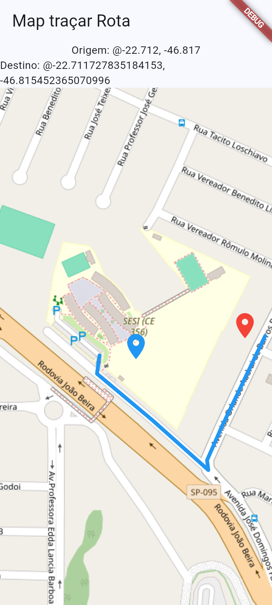

# Flutter Maps — Traçando Rotas com OSRM

Projeto desenvolvido com base no tutorial de Flutter Maps para rotas.

##  Tecnologias utilizadas

- **Flutter:** desenvolvimento da interface do aplicativo.
- **Dart:** linguagem de programação.
- **flutter_map:** exibição do mapa interativo.
- **latlong2:** manipulação de coordenadas geográficas.
- **HTTP:** comunicação com a API de rotas.
- **OpenStreetMap:** fornecimento dos mapas.
- **OSRM API:** cálculo de rotas entre dois pontos.

## Funcionalidades

- Visualização de mapa interativo.
- Seleção de pontos de origem e destino.
- Cálculo de rotas utilizando a API OSRM.
- Representação visual do percurso no mapa.
- Consulta de informações sobre o trajeto, conforme implementado no aplicativo.

## Captura de tela

Confira abaixo o registro do aplicativo em funcionamento.



## Como executar o projeto

### Pré-requisitos

- Flutter SDK instalado.
- Dart instalado com o Flutter.
- Google Chrome.
- Conexão com a internet.

### Instalação

Clone o repositório:

```bash
git clone https://github.com/Juhgabrielly/flutter_maps_rotas.git
```

Entre na pasta do projeto:

```bash
cd flutter_maps_rotas
```

Instale as dependências:

```bash
flutter pub get
```

Execute o aplicativo no navegador:

```bash
flutter run -d chrome
```

## APK para Android

O arquivo APK para instalação em dispositivos Android está disponível na pasta `assets/`.

**Arquivo:** `assets/flutter_maps.apk`
